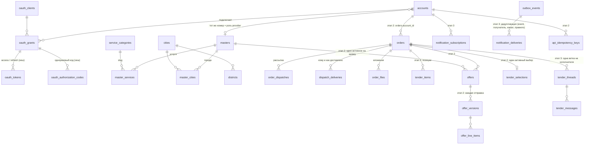

# Этап 0: обследование backend и контракт API для плагина ChatGPT

ТЗ «Xtender: техническое задание на API для плагина ChatGPT», версия 1.1 от 23.10.2026 (прислал владелец). Документ —
результат этапа 0 (раздел 18 ТЗ): что в коде уже есть, что переиспользуем, что доработать и что создать, модель доступа,
ER-диаграмма, план миграций и решения, которых не хватает. Этап 1 сделан в том же заходе, раздел 9.

Состояние на 2026-10-23: этапы 0 и 1 сделаны в рабочей копии, **не закоммичены и не выложены**. В тот же день
учтены первые замечания к отчёту (раздел 10) и добавлена готовность к выкладке (раздел 11). Связанные файлы:
[openapi.yaml](openapi.yaml) — контракт (сделанное и запланированное), [AUTH.md](AUTH.md) — вход OAuth,
[README.md](README.md) — как пользоваться API и песочницей.

## 1. Что такое Xtender сейчас

- **Стек.** Node.js, Express 4, шаблоны EJS, PostgreSQL (`pg`), Redis (коды из SMS, лимиты), Railway. Монолит из папок
  `controllers` / `services` / `config` / `routes`; модулей в смысле ТЗ нет, но границы по сервисам читаются. Схема
  `schema.sql` выполняется при каждом старте (идемпотентные `CREATE … IF NOT EXISTS` и `ALTER … ADD COLUMN IF NOT EXISTS`),
  отдельных миграций и плана отката нет. Тесты — `node --test tests/*.test.js` на pg-mem.
- **Как идёт заявка.** Заказчик пишет задачу текстом, вводит грузинский номер и код из SMS → заявка `pending_review` →
  модератор (Telegram или кабинет менеджера `/manager`) выбирает услуги и характеристики → рассылка подходящим
  исполнителям по SMS или Telegram (`order_dispatches`, `dispatch_runs`, `dispatch_deliveries`) → исполнитель открывает
  ссылку и сам звонит или пишет в WhatsApp (`order_views`). **Предложений с ценой и выбора исполнителя в системе нет**:
  договорённость — по телефону. Заказчик закрывает заявку сам (`/o/<owner_token>`).
- **Аккаунтов заказчика нет.** Заказчик — подтверждённый номер в `orders.phone`; его страница — секретная ссылка
  `/o/<owner_token>`, список заявок — по куке браузера.
- **Исполнитель** — строка `masters` (номер E.164, услуги `master_services` с характеристиками, города `master_cities`,
  языки `spoken_languages`). Регистрация на `/join`: две галочки согласия, снимок текстов, код из SMS, затем модератор.
  Услуги и характеристики назначает модератор. Сейчас бесплатный период: в платном режиме исполнитель платит за
  доставку заявки и за показ номера в каталоге.
- **Для ИИ-ассистентов уже есть** ([ai-agent-api.md](../ai-agent-api.md)): ссылка `/draft` с готовой заявкой,
  `/llms.txt`, `POST /v1/rfq/create|verify`, анонимный MCP-сервер `/mcp` (два инструмента только на чтение),
  кнопка «Решить с ChatGPT». Всё это остаётся; API v1 — отдельный путь для подключённого аккаунта.

## 2. Карта ТЗ → код

| Модуль ТЗ | Что есть сейчас | Решение | Этап |
|---|---|---|---|
| identity: пользователи, роли, сессии | Нет аккаунтов. Вход исполнителя в кабинет по коду (`master_session` в Redis), админка по паролю и SMS | **Создано**: `accounts` (номер = аккаунт), OAuth 2.1 (`oauth_*`), роли считаются из `masters`. Код из SMS — существующий `otp.service` | 1 ✅ |
| Профиль исполнителя | `masters`, `master_services`, `master_cities`, `spoken_languages`, `is_subscribed`, отзывы | **Переиспользовано** без новых таблиц: чтение целиком, правка языков и приёма заявок (то, что исполнитель и сейчас меняет сам) | 1 ✅ |
| catalog: категории, схемы, синонимы | `service_categories` (код, названия ka/ru/en, `fields` с правилами подбора, `is_active`, `version`), редактор `/admin/categories`, словарь поиска `service-search-words.js` | **Переиспользовано**: поиск по тому же словарю, JSON Schema из `fields`, версии — хеш определения. Новая категория из админки появляется в API сама | 1 ✅ |
| Регионы | `cities` (включаются в `/admin/cities`), `districts` (10 районов Тбилиси) | **Переиспользовано**: `country:GE`, `city:<slug>`, `district:<slug>` | 1 ✅ |
| Единицы | Подписи в характеристиках по-русски («м³», «чел.») | **Создано**: справочник `config/units.js` с кодами и сопоставлением старых подписей | 1 ✅ |
| tenders: заявки, позиции, версии | `orders` (текст, район, город, `target_categories`, `requirements`, статусы модерации, `revision_version`) | **Доработать**: Tender = строка `orders` + новые поля и позиции (`tender_items`), а не вторая база заявок (ТЗ, преамбула). Модератор остаётся в цепочке | 2 |
| offers: предложения, строки, версии | Нет. «Отклик» — нажатие «Позвонить» / WhatsApp (`order_views`) | **Создать**: `offers`, `offer_versions`, `offer_line_items`. Требует решения владельца (раздел 8, вопрос 1) | 2 |
| Выбор и подтверждение | Нет. Заказчик закрывает заявку с причиной (`closing_reason`) | **Создать**: `tender_selections` с одним активным выбором на заявку (уникальный индекс) | 2 |
| dispatch: рассылка | Есть и работает: подбор по услугам, характеристикам, городу и языку, учёт доставок, досылка новым | **Переиспользовать**: публикация из API ставит заявку в ту же очередь модератора | 2 |
| conversations: уточнения | Нет (поддержка исполнителя с модератором — `support_messages`, к заявкам не относится) | **Создать**: `tender_threads`, `tender_messages` | 3 |
| attachments | `order_files` на диске контейнера (`public/uploads`, multer), 5 файлов × 5 МБ; Volume на Railway не подтверждён | **Доработать**: вынести в хранилище с временными ссылками до вложений через API | 3 |
| notifications: SMS заказчику по правилам | SMS-шлюз (`sms.service`), журнал доставок `sms_consent_logs`, согласия при заявке | **Создать**: настройки, подписки, история уведомлений, тихие часы; шлюз и журнал — переиспользовать | 3 |
| Ссылка возврата `/r/<token>` | Есть похожие: `/o/<owner_token>`, `lead_links` (хеш ключа) | **Создать** по образцу `lead_links` (хранить хеш) | 3 |
| Outbox, worker, повторы | Нет: SMS уходят из запроса или фоном в том же процессе; фоновые задачи — `setInterval` в процессе | **Создать** `outbox_events` + обработчик в том же процессе (модульный монолит, ТЗ 17) | 2–3 |
| Идемпотентность | Частично: `request_key` у пополнений и выплат | **Создать** `api_idempotency_keys` для всех внешне значимых POST | 2 |
| audit | `sms_consent_logs` (только запись), `master_admin_events`, `manager_portal_events` | **Переиспользовано**: подтверждение входа пишется в `sms_consent_logs` (`OAUTH_SMS_OTP_VERIFIED`), правка профиля из API — в `master_admin_events` | 1 ✅ |
| Админка каталога | `/admin/categories` с журналом версий (`version`), `/admin/cities` | **Переиспользовано**. Нет: вида «товары», параметров заявки отдельно от характеристик исполнителя (раздел 8) | 1–2 |
| Health, метрики | `GET /health` без проверки базы | **Доработать**: readiness с базой и Redis, счётчики очередей и повторов SMS | 4 |
| MCP-адаптер | Анонимный `/mcp` с двумя инструментами | **Доработать**: инструменты поверх тех же сервисов, вход по токену OAuth | 5 |

## 3. Модель доступа

- **Аккаунт** определяется только токеном. Полей `customer_id` / `provider_id` во входных данных нет; чужой id в запросе
  ничего не даёт (тест `api-v1-profile`).
- **Роли** считает сервер: `customer` — у каждого аккаунта; `provider` — если в `masters` есть профиль с тем же номером
  и он не заблокирован (`pending` тоже роль, со статусом). Роль нельзя выдать запросом; администратора в API нет.
- **Области доступа (scopes)** — все девять из ТЗ в контракте; при входе можно запросить только те, у которых есть сделанные
  операции (сейчас `profile:read`, `profile:write`), — экран согласия не обещает того, чего API ещё не умеет.
- **Объект**: этап 1 работает только со своим аккаунтом, своим профилем и своими сессиями; чужая сессия — тот же 404, что
  несуществующая. Для этапа 2 правила ТЗ (раздел 4) переносятся как есть: заказчик — свои заявки и все предложения по ним;
  исполнитель — доступные опубликованные заявки и свои предложения; номер заявки не даёт доступа.
- **Отключённый аккаунт** (`accounts.status = disabled`) читает, но не пишет; отключить приложение может всегда.
- **Контакты**: по ТЗ точный адрес и телефон заказчика — только назначенному исполнителю. Сейчас исполнитель, получивший
  заявку, видит телефон заказчика и звонит сам — это и есть модель сайта. Решение — раздел 8, вопрос 4.

## 4. Статусы: `orders` и Tender

| Сейчас (`orders.status`) | Tender (ТЗ) | `publication_status` (предлагается) |
|---|---|---|
| `unverified` (ждёт кода из SMS) | `draft` | `not_published` |
| `pending_review`, `needs_revision` | `open` после публикации, но заявка ещё у модератора | `in_review`, `needs_revision` |
| `new` (разослана) | `open` | `published` |
| — | `closed`, `selection_pending`, `awarded`, `completed` | `published` |
| `closed` (заказчиком или админом) | `cancelled` до выбора или `completed` | — |

Модерация — отдельная ось (`publication_status`), а не новые значения статуса: ТЗ задаёт статусы сделки, сайт добавляет
проверку модератором (решение владельца 2026-10-19 для заявок через ассистента). `dispatch_summary` строится из
`dispatch_deliveries`: `delivered` остаётся `null` — подтверждения доставки от SMS-шлюза нет.

## 5. ER-диаграмма

Сплошные — есть сейчас (этап 1 создал `accounts` и `oauth_*`); `tender_*`, `offer*`, `outbox_events`, `api_idempotency_keys`
и уведомления — предложение для этапов 2–3.

## 6. План миграций

**Правила для всех этапов** (история проекта: `schema.sql` выполняется при каждом старте, инциденты 2026-09-30 и
2026-10-05 в [tasks.md](../tasks.md)):
- новые `CREATE TABLE` — выше строки `-- Multiple provider services and immutable dispatch context.` (иначе ломается
  `tests/multi-service-dispatch.test.js`), `CHECK` — с явными именами (особенность pg-mem);
- никаких удалений и переписываний данных при старте; данные для новых таблиц — только с условием «ещё не сделано»;
- каждую схему прогонять на настоящем Postgres: схема HEAD с данными, затем новая дважды;
- откат этапа — откат коммита: новые таблицы и колонки старый код не читает, удалять их не нужно.

**Этап 1 (сделано):** `accounts`, `oauth_clients`, `oauth_grants`, `oauth_authorization_codes`, `oauth_tokens`. Старые
таблицы не изменены. Проверено на Postgres 18 (раздел 9).

**Этап 2 (предложение):** колонки `orders`: `account_id`, `kind`, `title`, `submission_deadline`,
`requested_start_at`, `requested_end_at`, `timezone`, `budget_max_minor`, `budget_visibility`, `currency`, `api_version`
(версия для If-Match), `schema_versions JSONB`, `project_id`; таблицы `tender_items`, `projects`, `offers` (уникальный
частичный индекс «одно активное предложение исполнителя на заявку»), `offer_versions`, `offer_line_items`,
`tender_selections` (уникальный частичный индекс «один активный выбор»), `api_idempotency_keys` (уникально: аккаунт,
метод, путь, ключ; хеш тела, ответ, срок 24 ч), `api_operations`, `outbox_events`. Фоновая обработка — в том же процессе
по образцу `siteAnalytics.start()`, с блокировкой строки (`FOR UPDATE SKIP LOCKED`), чтобы второй экземпляр не повторил.

**Этап 3 (предложение):** `tender_threads` (уникально: заявка + исполнитель), `tender_messages`, `api_attachments`
(хранилище вне диска контейнера), `notification_preferences`, `notification_subscriptions`, `notification_deliveries`
(уникально: событие, получатель, канал, правило), `resume_links` (хеш токена, срок).

## 7. Отличия этапа 1 от ТЗ

| ТЗ | Сделано | Почему |
|---|---|---|
| `kind` service/goods, иерархия `parent_id` | Все категории `service`, `parent_id = null` | Справочник плоский, товаров нет. Нужен флаг в редакторе категорий (раздел 8) |
| `included_services` / `excluded_services` | `null` | Таких данных нет; `null` — «неизвестно», не «пусто» (ТЗ 5) |
| `attribute_schema` — этаж, лифт, объём, работники | Схема — характеристики услуги с правилом подбора (`exact`, `gte`, `flag`): размер и тип кузова, бригада, объём, тоннаж, высота | Справочник описывает исполнителя; по этим же полям модератор подбирает исполнителей под заявку. Этажа и лифта нет — раздел 8 |
| `required_for_publish` | `[]` | На сайте заявка — свободный текст; обязательных параметров нет |
| `schema_version` — версия схемы | Хеш определения полей (`cs_…`) | Меняется сам при любой правке в `/admin/categories` и при правке встроенных полей в коде; счётчик `version` в базе последнее не видит |
| `version` у каждого объекта | У аккаунта — число; у профиля исполнителя — хеш данных (`pv_…`) | Профиль правят админка, кабинет менеджера и сам исполнитель: счётчик пришлось бы вести во всех местах |
| `PUT /me/provider-profile` регистрирует роль provider | 409 `PROVIDER_REGISTRATION_REQUIRED` со ссылкой на `/join` | Регистрация — согласие с Офертой, публикация контактов и код из SMS на странице сайта; повторять её в чате нельзя |
| Профиль: специализации, регионы, описание | Только чтение; правка — 422 `MODERATOR_ONLY` | Влияет на рассылку и каталог; решение владельца 2026-09-01 — меняет модератор |
| OAuth: CIMD или DCR | DCR (RFC 7591) со списком разрешённых адресов возврата (ChatGPT, Claude) | CIMD требует скачивать документ клиента по ссылке; ТЗ запрещает серверу скачивать произвольные адреса |
| Токены | Непрозрачные, проверка по базе (хеш) | Сервер авторизации и API — одно приложение; JWT ничего не добавляет, а отзыв сессии должен действовать сразу |
| Сообщения об ошибках | По-английски, коды стабильные | Читает модель; человеку объясняет она на его языке |
| Отдельные production и sandbox | Песочница — `XTENDER_SANDBOX=1`: локально `scripts/api-sandbox.js` (pg-mem); развернуть отдельно — решение владельца | Отдельного окружения на Railway нет |
| Idempotency-Key у POST | Не нужен на этапе 1 | Внешне значимых POST в этапе 1 нет; вход OAuth защищён одноразовостью кода |
| health/readiness, метрики | Не сделано | Этап 4 |

## 8. Решения, которых не хватает

Технические умолчания этапа 1 обратимы и не меняют прав и внешних обязательств (ТЗ 18). Для этапа 2 нужны ответы
владельца — без них этап 2 меняет модель сайта, как и «модули 3–4» прошлого ТЗ ([ai-agent-api.md](../ai-agent-api.md), раздел 8).
**Ответы владельца 2026-10-23 — раздел 12**; вопросы ниже оставлены как были заданы.

1. **Предложения с ценой внутри Xtender.** Сейчас исполнитель звонит заказчику, цена — по телефону (решение 2026-09-01:
   «платформа не посредничает в цене»). ТЗ вводит предложения, сравнение и выбор. Делаем предложения рядом со звонком или
   вместо него? И за что платит исполнитель в платном режиме — за заявку (как сейчас), за отправленное предложение или
   за выбор? *Рекомендация*: рядом со звонком; в бесплатный период вопрос оплаты отложить, но решить до включения платного режима.
2. **Модератор перед рассылкой.** Для заявок через ассистента решено 2026-10-19: модератор остаётся. ТЗ пишет «публикует и
   ставит рассылку в очередь». *Рекомендация*: оставить модератора, `publication_status: in_review`.
3. **Кто видит опубликованные заявки** (`listOpportunities`): только те, кому модератор разослал, или все подходящие по
   услуге и городу? В платном режиме свободный просмотр обходит плату за заявку. *Рекомендация*: только получившие рассылку.
4. **Телефон заказчика до выбора.** ТЗ: до назначения — только район и условия. Сайт сейчас даёт телефон получившему
   заявку. Для заявок из ChatGPT скрывать телефон до выбора? Тогда связь — только переписка (этап 3).
   *Позиция из обсуждения 2026-10-23 (не окончательная)*: поддержать обе модели — человек может хотеть быстро получить
   звонки или спокойно сравнить письменные предложения. Для этого заказчик выбирает способ у каждой заявки: «пусть
   звонят» (телефон получившим заявку, как сейчас) или «пришлите предложения» (телефон только выбранному). Нужно
   подтвердить формулировку и решить, что выбрано по умолчанию.
5. **Сроки по умолчанию**: сбор предложений (например, 24 или 48 часов), ответ выбранного исполнителя (ТЗ: 24 часа).
6. **Товары.** Услуги «Стройматериалы» в каталоге нет, вида «товары» в справочнике нет. Добавить в редактор категорий
   выбор «услуга / товары»?
7. **Параметры заявки** (этаж, лифт, дата) отдельно от характеристик исполнителя: добавить в редактор категорий отметку
   «спрашивать у заказчика»?
8. **SMS заказчику по правилам** («первое предложение», «3 предложения»): каждое SMS стоит денег; текст согласия на такие
   SMS — к юристу вместе с Офертой.
9. **Согласие с Офертой при публикации из ChatGPT.** Вход в приложение — подтверждение номера, не согласие. Для публикации
   нужен снимок согласия. *Рекомендация*: первая публикация открывает страницу xtender.ge с галочками (как `/draft`),
   дальше согласие хранится у аккаунта до смены версии текстов. К юристу.
10. **Хранилище файлов**: Railway Volume или объектное хранилище — до вложений этапа 3 (открытая задача «Volume для загрузок»).
11. **Песочница на Railway**: отдельное окружение с своей базой и `XTENDER_SANDBOX=1` или только локальная.
12. **Выкладка этапа 1 на xtender.ge**: новые адреса `/oauth/*`, `/.well-known/oauth-*`, `/api/v1/*` и пять таблиц. Для людей
    на сайте ничего не меняется. Разрешения на выкладку нет: её подтверждают отдельно, после проверки миграций,
    резервной копии и плана отката (раздел 11).
13. **Каталог плагинов ChatGPT** (этап 5): аккаунт разработчика OpenAI владельца, политика конфиденциальности (есть), иконка,
    примеры запросов.

## 9. Этап 1: что сделано и как проверено

Сделано: вход OAuth 2.1 по номеру и коду из SMS (метаданные RFC 8414 / RFC 9728, регистрация клиента RFC 7591, PKCE S256,
`iss` в ответе по RFC 9207, ротация refresh-токена, отзыв RFC 7009); `GET /capabilities`, `GET/PATCH /me`,
`GET/PUT /me/provider-profile`, `GET /me/sessions`, `DELETE /me/sessions/{id}`, `GET /categories` с поиском,
`GET /categories/{id}/schema`, `GET /locations`, `GET /units`, `GET /openapi.json`; песочница (`XTENDER_SANDBOX=1`:
SMS в приёмник, Telegram выключен), `scripts/api-sandbox.js` с заказчиком и двумя исполнителями,
`scripts/api-sandbox-token.js`.

Проверено:
- `node --test tests/*.test.js` — 82 из 82 (новые: `api-v1-auth`, `api-v1-catalog`, `api-v1-profile`, `api-v1-openapi`,
  `api-v1-sandbox`; прежние не задеты);
- те же четыре теста на настоящем PostgreSQL 18 (`API_TEST_DATABASE_URL`, embedded-postgres): все проходят; схема HEAD с
  данными, затем новая дважды — без ошибок, новые таблицы на месте, данные исполнителей не тронуты;
- `docs/api-v1/openapi.yaml` разобран js-yaml и совпадает с кодом; Redocly CLI 1.25: «valid», одно предупреждение (нет
  `license`);
- страница входа в Chromium на ka/ru/en при ширине 320/360/412 px: три шага до перехода к клиенту с `code` и `iss`, страница
  не шире экрана;
- не проверено: настоящий ChatGPT (этап 5), настоящая SMS со входом (код уходит через тот же шлюз, текст `oauthCode` новый).

Критерии раздела 16, этап 1: новая категория из админки находится без нового адреса и правки кода (тест); после правки
меняется `catalog_version`, кеша каталога нет (числа исполнителей кешируются на 5 минут, с `checked_at`); выключенная
категория не предлагается, но её схема читается; эталонные запросы на трёх языках и нерелевантные зафиксированы в
`tests/api-v1-catalog.test.js`; `available_to_user` зависит от роли, области и состояния аккаунта; схема описывает
недостающие поля без знания профессии.

## 10. Замечания к отчёту, 2026-10-23

1. **Обе модели связи** — позиция записана в вопросе 4 раздела 8: заказчик выбирает у заявки «пусть звонят» или
   «пришлите предложения». Не окончательно.
2. **Профиль исполнителя через модератора** — ограничение принято. Позже человек должен видеть, что услуги и регионы
   меняются обращением к модератору. Сейчас API отвечает 422 `MODERATOR_ONLY` и отдаёт `moderated_fields`, но не говорит,
   куда обращаться. Предложение: в профиле и в этой ошибке — путь обращения (чат поддержки в кабинете исполнителя
   `/master`, вкладка «Профиль»), а в MCP-инструменте — фраза для человека. Не сделано.
3. **Доступ только к сделанному** — принято: объявлены лишь области со сделанными операциями (AUTH.md, раздел 4).
4. **Проверка в ChatGPT до этапа 2** — принято как обязательный шаг «этап 1б»: вход с настоящей SMS и минимальный
   OAuth-сценарий в ChatGPT. Найденная несовместимость исправляется до остальных действий. Что для этого нужно:
   - сервер, доступный ChatGPT по HTTPS, с настоящим SMS-шлюзом: либо xtender.ge после подтверждённой выкладки,
     либо отдельное окружение Railway со своей базой (без `XTENDER_SANDBOX`, с ключами шлюза, без ключа Telegram).
     Локальная песочница не подходит: ChatGPT её не видит, настоящих SMS в ней нет, а продовый `.env` локально не
     запускаем;
   - ChatGPT подключается к MCP-серверу, а `/mcp` сейчас без входа. Минимум — один инструмент «чей это аккаунт»
     (`profile:read`, `securitySchemes: oauth2`), прежние два инструмента остаются без входа (`noauth`); без токена
     инструмент отвечает ошибкой с `_meta["mcp/www_authenticate"]`. Это малая часть этапа 5, перенесённая вперёд;
   - проверить: регистрацию клиента (DCR) или CIMD — что выберет ChatGPT; адрес возврата; `iss`; обмен кода; вызов
     инструмента с токеном; обновление токена через час; отключение приложения в ChatGPT и что после этого с сессией
     у нас.
5. **Выкладка** — только отдельным подтверждением после раздела 11.

## 11. Готовность этапа 1 к выкладке: миграции, резервная копия, откат

**Миграции.** Только добавление: пять `CREATE TABLE IF NOT EXISTS` (`accounts`, `oauth_clients`, `oauth_grants`,
`oauth_authorization_codes`, `oauth_tokens`) и три индекса. Существующие таблицы, колонки и данные не меняются, команд с
данными нет. `schema.sql` выполняется при старте; ошибка в нём не даёт сайту подняться (прецедент 14–15.09), поэтому:
- проверено на PostgreSQL 18 (embedded-postgres): схема HEAD с исполнителем в базе, затем новая схема дважды — без ошибок,
  данные на месте; четыре теста API на той же базе проходят;
- не проверено: на копии боевой базы (доступа нет) и на версии Postgres, которая стоит на Railway (версию сессия не знает).
  Если копия будет — тот же прогон на ней.

**Резервная копия.** Порядка резервного копирования в документах проекта нет, включены ли резервные копии у сервиса
Postgres на Railway — неизвестно. Перед выкладкой владелец делает копию базы: встроенной копией Railway, если она есть
у сервиса, или `pg_dump` по внешнему адресу базы. Отметить в задаче, где лежит копия и как из неё восстановить.

**Откат.** `git revert` коммита этапа 1 и новая выкладка. Старый код новых таблиц не читает, поэтому их можно оставить:
данные в них — аккаунты и сессии подключения, сайт без них работает. Полное удаление, только вручную и после отката:
`DROP TABLE oauth_tokens, oauth_authorization_codes, oauth_grants, oauth_clients, accounts;` — удаляет сессии и аккаунты
навсегда, автоматически не выполняется. Ключи Redis этапа 1 (`oauth_req:*`, `oauth_limit:*`, `otp*:oauth:*`, `api_rate:*`)
истекают сами; `api_catalog_version` — одна запись без срока (время смены версии каталога), её можно удалить вручную.
Записи `OAUTH_SMS_OTP_VERIFIED` в журнале согласий остаются (журнал только для записи).

**Что включается вместе с кодом.** Открытые адреса `/.well-known/oauth-*`, `/oauth/*`, `/api/v1/*`. Регистрация клиента
открыта, но адреса возврата — только ChatGPT и Claude. Страница входа отправляет настоящие SMS: 10 отправок кода в час с
одного адреса, 3 кода в час на номер. Песочница (`/api/v1/sandbox/sms`) на рабочем сайте отвечает 404. Затронутые общие
файлы перечислены в задаче «API для плагина ChatGPT» в [tasks.md](../tasks.md).

**После выкладки.** Railway `success`; `/health`, главная и `/api/masters` как раньше; `/.well-known/oauth-authorization-server`
отдаёт `issuer: https://xtender.ge`; `/api/v1/capabilities` — `environment: production`; `/api/v1/sandbox/sms` — 404; в Deploy
Logs «Database schema is up to date». Затем этап 1б.

## 12. Решения владельца по разделу 8, 2026-10-23

Владелец передал список решений для согласования. Это решения для проектирования этапов 2–5, **не разрешение менять
рабочий сайт**: выкладка по-прежнему решается отдельно (решение 12).

| № | Решение | Что это значит для разработки |
|---|---|---|
| 1 | Предложения — рядом со звонками. Порядок оплаты не менять, новых списаний за предложение или выбор не вводить | Предложения и выбор не пишут в `balance_transactions`. В платном режиме списания прежние: доставка заявки и показ номера |
| 2 | Модерация остаётся. ChatGPT сообщает «Заявка передана на проверку», пока модератор не разрешил рассылку | `publication_status: in_review`; инструмент MCP отдаёт эту фразу, а не «опубликовано» |
| 3 | Доступ к заявке — только исполнителям, которым он предоставлен при рассылке. Доступ фиксируется отдельно от успешной доставки SMS | Своя запись доступа (заявка, исполнитель, рассылка, время) рядом с `dispatch_deliveries`: SMS могла не дойти, а доступ есть. `listOpportunities` и права на заявку читают её |
| 4 | Новые заявки из ChatGPT — по умолчанию «Сначала предложения»; заказчик может включить «Можно звонить». Существующие заявки — как сейчас | Способ связи у заявки: «сначала предложения» — телефон только выбранному исполнителю после подтверждения; «можно звонить» — как сейчас. Заявки с сайта и старые — «можно звонить» |
| 5 | Сбор — 24 часа по умолчанию, но согласовывать с датой работ. Подтверждение выбранным исполнителем — до 24 часов и обязательно раньше начала работ; для срочных задач — меньше | Срок сбора и срок подтверждения считаются от даты работ: не позже начала, не дольше 24 часов. Проверка — в `validateTender` и при выборе |
| 6 | Вид «товары» (goods) и категории товаров в редакторе; названия и ассортимент задаёт администратор | Колонка вида у категории и выбор в `/admin/categories`; `searchCategories?kind=goods` начинает отдавать категории |
| 7 | Разделить характеристики исполнителя и требования заявки, сохранив явное сопоставление для подбора | См. уточнение 1. `getCategorySchema` станет схемой требований, `schema_version` сменится |
| 8 | SMS в MVP: первое предложение и завершение сбора, с согласием и отключением. Совпали события — одно сообщение | Два правила; события одной заявки в одном окне объединяются в одну SMS (дедупликация в outbox) |
| 9 | Отдельная страница Xtender при первой публикации; сохранять версию текста и подтверждение. Согласие на SMS — отдельно | Страница по образцу `/draft` с галочками; снимок в `sms_consent_logs`; согласие на SMS — отдельная галочка и отдельная запись |
| 10 | Объектное хранилище с закрытым доступом и временными ссылками. До переноса новые загрузки через API не включать | Вложения API — только после переноса `order_files` |
| 11 | Песочница — отдельное HTTPS-окружение со своей БД и Redis. Рассылки отключены; настоящая SMS для проверки входа — только на разрешённые тестовые номера | `XTENDER_SANDBOX=1` + список разрешённых номеров для кодов входа (раздел 13) |
| 12 | Сначала тестовое окружение и этап 1б. Публичная выкладка — отдельное решение после проверки | Порядок: этап 1б → решение о выкладке → этап 2 |
| 13 | Сначала приватное подключение и проверка полного сценария. Публичный каталог — после | Режим разработчика ChatGPT на аккаунте владельца; заявка в каталог плагинов — последней |

### Уточнения для разработки

1. **Требования заявки — отдельно от фильтров исполнителя.** «Объём мусора — 2 м³» — требование заявки, «машина
   вмещает 5 м³» — характеристика исполнителя; их связывает правило подбора. Одной галочки «спрашивать у заказчика»
   недостаточно: в справочнике категории — список требований (поля ввода заказчика), список характеристик исполнителя
   и правило, которое связывает требование с характеристикой (`≤`, `=`, «нужно → есть»).
2. **Отклики — только у разосланной заявки.** Если Tender остаётся `open`, предложения принимаются только при
   `publication_status = published` и действующем сроке. Срок сбора идёт от разрешения рассылки, а не от создания:
   пока заявка у модератора, он не истекает незаметно.
3. **Переписка — в этап 2.** При скрытом телефоне нужна возможность уточнить условия: минимальная переписка (одна ветка
   заказчик — исполнитель, текст без вложений) переносится в этап 2. Без неё режим «Сначала предложения» не включается.
4. **Старые заявки и аккаунты.** Без отдельного решения старые заявки к аккаунту не привязываются, даже при совпавшем
   номере: история заявок не открывается автоматически. Новые заявки из API получают `account_id` сразу.
5. **Два разных состояния аккаунта.** «Только чтение» (запись запрещена) и «заблокирован» (например, при компрометации:
   нет ни чтения, ни записи, сессии не действуют). Сделано после этих решений — раздел 13.

### Что меняется в плане

- **Этап 1б** (до этапа 2): тестовое HTTPS-окружение, вход с настоящей SMS на разрешённый номер, приватное подключение
  в ChatGPT и минимальный OAuth-сценарий (раздел 10, пункт 4).
- **Этап 2** дополнительно: запись доступа к заявке, способ связи у заявки, минимальная переписка, `account_id` у новых
  заявок, приём откликов только у разосланной заявки, требования заявки отдельно от характеристик исполнителя, вид «товары».
- **Этап 3**: SMS по двум правилам MVP; вложения — после переноса файлов в хранилище.
- **Неизвестно и проверяет владелец**: версия PostgreSQL на Railway и возможность восстановить базу из копии (раздел 11).
